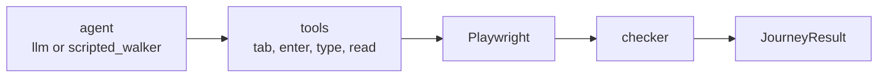

# Haunted Audit

Kiroween 2026, Costume Contest. An accessibility engineer for AI-built applications.

## Project Overview

Haunted Audit watches a keyboard-only agent, and a voice-command simulation, try to send a payment, using made-up details you type yourself, on a small test bank called Haunted Bank. The keyboard agent can tab, type, and read what is focused. It cannot click. The voice simulation acts only on a control's accessible name. A fixed checker, not the AI, decides whether the payment journey passed.

Two pages live in `fixtures/haunted_bank/index.html`:

- `?variant=broken` uses a `div.pay-btn`. It looks like a button but is not in the tab order, so the journey is blocked.
- `?variant=fixed` uses a real submit button. Enter on that button shows the payment confirmation.

The live screen is a React dashboard. It starts a run, shows each keystroke, and paints a ghost beside the control the checker measured. Numbers stay `--` until a run actually measures them.

You do not need an API key to see this. **Scripted** mode is the local demo. **LLM** mode is optional and calls Claude on Amazon Bedrock.

## Prerequisites

Install these before you start:

| Tool | Version | Why |
| --- | --- | --- |
| Git | any current version | clone the repository |
| Python | 3.11 or newer | the agent, the checker, and the API |
| Node.js | 22 (20 or newer also works) | the dashboard |
| npm | comes with Node.js | installs the dashboard |

Check them:

```bash
git --version
python3.11 --version
node --version
npm --version
```

On macOS, if `python3.11` is missing, install it from [python.org](https://www.python.org/downloads/) or with `brew install python@3.11`.

API keys are optional.

1. Copy the example file. It contains only placeholders, never real secrets:

   ```bash
   cp .env.example .env
   ```

2. Leave the AWS lines as they are if you only want the scripted demo.
3. Fill them in only for LLM mode. The names the code reads are in `.env.example`:

   - `AWS_REGION` and `AWS_DEFAULT_REGION`
   - `AWS_ACCESS_KEY_ID`, `AWS_SECRET_ACCESS_KEY`, and `AWS_SESSION_TOKEN` if your account uses a temporary token
   - `BEDROCK_MODEL_ID` (default `us.anthropic.claude-sonnet-4-6`)
   - `BEDROCK_TEMPERATURE` and `BEDROCK_MAX_TOKENS`
   - `BEDROCK_INPUT_USD_PER_MTOK` and `BEDROCK_OUTPUT_USD_PER_MTOK` (used only to price real token counts)
   - `HAUNTED_AUDIT_DB` (SQLite file, default `data/runs.db`)
   - `LLM_ENABLED` (leave `false` unless you want the API to accept LLM runs)

The dashboard has its own optional file, `dashboard/.env.example`. Leave `VITE_API_URL` blank on your machine. The dev server then talks to `http://127.0.0.1:8000` for you.

`.env` is listed in `.gitignore`. Do not commit it.

## Option A: Quick Start in Kiro

1. Clone the repository and open that folder in Kiro:

   ```bash
   git clone https://github.com/charvimaurya/haunted-audit.git
   cd haunted-audit
   ```

2. Open the Kiro chat and paste this prompt as one message:

```text
Set up and launch Haunted Audit from this folder. Do not invent credentials and do not commit anything.

1. Confirm Python is 3.11 or newer and Node.js is installed. If Python 3.11 is missing, stop and tell me how to install it.
2. Create a virtual environment at .venv with that Python. Install packages from requirements.txt into .venv. Then install Chromium for Playwright with: .venv/bin/python -m playwright install chromium
3. If .env does not exist, copy .env.example to .env. Leave the AWS placeholder values as they are. Do not open, print, or edit any real secrets. Scripted mode must work with those placeholders.
4. If dashboard/.env does not exist, copy dashboard/.env.example to dashboard/.env and leave VITE_API_URL blank.
5. In one terminal, from the repo root, start the API and leave it running:
   .venv/bin/python -m uvicorn agent.api.main:app --host 127.0.0.1 --port 8000
   The app object is create_app() in agent/api/main.py. It loads .env itself.
6. In a second terminal, start the dashboard and leave it running:
   cd dashboard && npm install && npm run dev -- --host 127.0.0.1 --port 5173
   Vite is configured in dashboard/vite.config.ts. It proxies /runs and /health to http://127.0.0.1:8000.
7. When both are up, tell me to open http://127.0.0.1:5173 and that the API health check is http://127.0.0.1:8000/health.
8. On the page, leave Variant on broken and Agent mode on scripted. Under Test details, type a made-up Recipient and Amount (for example 10.00), then press Run Journey.
```

3. Wait until the assistant says both servers are running.
4. Open [http://127.0.0.1:5173](http://127.0.0.1:5173). Leave **Variant** on `broken` and **Agent mode** on `scripted`. Under **Test details**, type a made-up Recipient and Amount (for example `10.00`); Reference is optional. Nothing is filled in for you, and Run Journey asks for them if they are empty. Then press **Run Journey**.

The API stays at [http://127.0.0.1:8000](http://127.0.0.1:8000). [http://127.0.0.1:8000/health](http://127.0.0.1:8000/health) should answer when the API is up.

## Option B: Manual Terminal Setup

Run these commands from a terminal. On Windows, use `py -3.11` instead of `python3.11`, and activate with `.venv\Scripts\activate` instead of `source .venv/bin/activate`.

```bash
git clone https://github.com/charvimaurya/haunted-audit.git
cd haunted-audit
python3.11 -m venv .venv
source .venv/bin/activate
python -m pip install -r requirements.txt
python -m playwright install chromium
cp .env.example .env
cp dashboard/.env.example dashboard/.env
```

`pip install` reads `requirements.txt` (FastAPI, Uvicorn, Playwright, Strands Agents, and the test tools). The copy steps create local env files from the examples. You can leave the placeholders blank for the scripted demo.

Start the API and leave that terminal open. This is the entry point `agent/api/main.py`:

```bash
python -m uvicorn agent.api.main:app --host 127.0.0.1 --port 8000
```

Open a second terminal, from the same repository folder:

```bash
source .venv/bin/activate
cd dashboard
npm install
npm run dev -- --host 127.0.0.1 --port 5173
```

Then open:

- Dashboard: [http://127.0.0.1:5173](http://127.0.0.1:5173)
- API health: [http://127.0.0.1:8000/health](http://127.0.0.1:8000/health)

On the dashboard, leave **Variant** on `broken` and **Agent mode** on `scripted`. Under **Test details**, type a made-up Recipient and Amount (for example `10.00`); Reference is optional. Nothing is filled in for you, and Run Journey asks for them if they are empty. Then press **Run Journey**. The broken page should end blocked, because Send Payment is not a real keyboard button. Switch **Variant** to `fixed` and run again to see the journey pass.

Stop either server with Ctrl+C in its terminal.

### Optional commands

One journey without the dashboard, from the repo root with the virtual environment active:

```bash
python -m agent.keyboard_agent.runner --variant broken --mode scripted
python -m agent.keyboard_agent.runner --variant fixed --mode scripted
```

LLM mode, only after real AWS values are in `.env`:

```bash
python -m agent.keyboard_agent.runner --variant fixed --mode llm
```

Tests and the five-run scripted check:

```bash
python -m pytest
python -m agent.eval.run_eval --modes scripted --runs 5
```

Dashboard tests, from the `dashboard` folder:

```bash
npm test
```

## What you should see

1. The landing ghost means Ready before anything has run.
2. **Live steps** fill in while the agent tabs and types. It never clicks.
3. On `broken`, the ghost turns red beside Send Payment, and the checker reports `BLOCKED` / `TARGET_NOT_FOCUSABLE` on `div.pay-btn`.
4. On `fixed`, the ghost turns green and the checker reports `PASSED`.
5. Unmeasured numbers stay `--`.
6. After a `broken` run, **Fixes** walks Find, Fix, Verify, Regression by keyboard. Verify shows **BLOCKED → VERIFIED** and two evidence rows, Keyboard journey and Voice-command simulation, each with its run ID. **Reports** shows the same two rows.
7. **Approve** plays a short exorcism: the red ghost glows and fades, beside "Exorcism started: a person approved the fix. The Verifier still has to prove it." The **Regression** step ends with **Before and after**: red BLOCKED from the first run, and green VERIFIED only when the Verifier's run passed. In Calm mode the same states show without movement.
8. After a run, the Possession checklist shows the values the agent typed, which are the ones you typed. Recorded replays (`docs/evidence-seed.json`) show the values typed when they were recorded.

If the page says it cannot reach the API, the first terminal is not running, or it is not on port 8000.

## How the pieces fit



The only keyboard tools are `press_tab`, `press_shift_tab`, `press_enter`, `press_space`, `press_arrow`, `type_text`, `read_focus`, `read_page`, and `declare_done`. A run stops at 25 steps or 90 seconds. `target_selector` is used by the checker only. It is never copied into the agent prompt.

The checker returns `PASSED` only when the success selector is visible. Otherwise it returns `BLOCKED` with `TARGET_NOT_FOCUSABLE`, `FOCUS_TRAP`, `NO_ACTIVATION`, `STEP_LIMIT`, or `TIMEOUT`.

API routes, once the first terminal is running:

- `POST /runs` with `{"variant": "broken" or "fixed", "mode": "llm" or "scripted"}`
- `GET /runs/{id}`
- `GET /runs/{id}/events` as Server-Sent Events
- `GET /health` and `GET /ping`

## Fix, verify, prevent

After a `broken` run ends `BLOCKED`, the fix loop runs on copies of the bank. No tracked file changes.

1. **Fix.** The Exorcist proposes a diff. A person approves or rejects it. Without AWS the fix is a **Scripted repair demonstration** (0 tokens): one diff with two fixed rules, so Send Payment becomes a real button and the Amount caption becomes a label. The diff is 4 changed lines in 2 hunks (measured 25 Nov 2026 on `fixtures/haunted_bank/index.html`). Only `exorcist_mode: "llm"` needs Amazon Bedrock.
2. **Verify.** The keyboard agent, then the voice-command simulation, run on the patched copy, each with its own run ID. The checker decides both. With the scripted fix both journeys pass on the patched copy, and with the bug put back both are blocked (25 Nov 2026: `agent/tests/test_loop_evidence.py::test_fail_006_is_fixed_voice_passes_on_the_patched_copy`, 1 passed). The screen then says **Keyboard and voice** (keyboard loop walk, `docs/pr/item-2-1-exorcist-closure.md`). Before 24 Nov the fix left the Amount field unlabelled and voice stayed blocked; that history is evals `fail-006`.
3. **Prevent.** The journey test `tests/journeys/send-payment.spec.ts` presses Tab until Send Payment has focus, then Enter. It catches the barrier when it comes back.

API routes for the loop:

- `POST /runs/{id}/fixes`, `GET /fixes/{id}`
- `POST /fixes/{id}/approve` (with the `diff_sha256` you reviewed) and `POST /fixes/{id}/reject`
- `POST /fixes/{id}/verify`, then `POST /fixes/{id}/regression` (the bug put back on a copy). Each returns `run_id` (keyboard) and `voice_run_id`.

The regression guard, from the repo root. Node.js is needed once for the journey test:

```bash
cd tests/journeys && npm install && npx playwright install chromium && cd ../..
python -m agent.fixes.regression_guard --runs 5
```

Each run writes three copies under `artifacts/regression/` and runs the test on each: fix applied PASS, fix removed FAIL ("Send Payment is not keyboard focusable"), fix restored PASS. Only that order prints `GUARD_WORKS`. A recorded 5-run output is in `docs/kiro-writeup/returning-ghost.txt`. The guard result is not a checker verdict.

## Eval

Five runs of each requested mode and variant. A mode is reliable only when at least 4 of 5 runs are correct. The report is written from the runs just executed.

```bash
python -m agent.eval.run_eval --modes scripted --runs 5
python -m agent.eval.run_eval
```

The default command includes `llm` and `scripted`. The decision is **GO** only when the LLM meets 4 of 5 on both variants. Otherwise it is **NO-GO**. Outputs land in `artifacts/eval/results.json` and `artifacts/eval/results.md`. Those folders are gitignored.

Scripted walker, 5 runs each, measured on one machine:

| mode | variant | correct | avg steps | avg latency | reliable |
| --- | --- | --- | --- | --- | --- |
| scripted | broken | 5 of 5 | 18.0 | 898 ms | yes |
| scripted | fixed | 5 of 5 | 14.0 | 756 ms | yes |

LLM mode was not scored: Amazon Bedrock credentials were not configured. Those missing runs are not a model accuracy. Re-run the eval on your machine to reproduce the scripted numbers.

## Kiro

Specs, steering rules, and the axe-on-save hook live in `.kiro/`. Rules decide anything that must be the same every time. The model is used only where judgement helps. A human approves anything that changes code.

## Layout

| Path | Role |
| --- | --- |
| `agent/keyboard_agent/` | Agent, scripted walker, tools, checker, runner |
| `agent/eval/run_eval.py` | Repeated runs and the GO / NO-GO report |
| `agent/api/main.py` | FastAPI app. This is the API entry point |
| `agent/tests/` | pytest and Hypothesis |
| `fixtures/haunted_bank/` | Static test site, broken and fixed |
| `dashboard/` | Vite + React UI. Entry is `dashboard/src/main.tsx` |
| `requirements.txt` | Python packages |
| `.env.example` | Placeholder environment variables |
| `.kiro/` | Specs, steering, and the axe-on-save hook |
| `docs/` | Team plans, schedule, judge deck, and evidence |

## Known issues
- **Internal test details.** A direct API call to `POST /runs` without `recipient` and `amount` (pytest, the eval scripts, the command line, Night Watch) still uses one built-in made-up name and amount: `INTERNAL_DEFAULT_DETAILS` in `agent/keyboard_agent/models.py`. That default is never sent to the dashboard as a typed value and never fills in a field. The same name also appears as test input in `agent/tests/` and `agent/eval/run_voice_eval.py`. The full list is in `docs/user-typed-test-details-audit.md`.
- **Design image.** The frozen v7 design image (`design/Haunted_Audit_Final_UI_v7.png`) shows an example name in the Recipient field. The app does not copy it.
