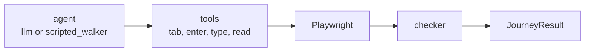

# Haunted Audit

Kiroween 2026, Costume Contest. Haunted Audit is an accessibility engineer for AI-built applications. A keyboard-only agent tries to send EUR 50 to Alex Carter on Haunted Bank. It can tab, type, and read focus. It cannot click. A deterministic checker, not the agent, decides whether the journey passed.

The fixture is `fixtures/haunted_bank/index.html`.

- `?variant=broken` renders `div.pay-btn`. It has an `onclick` and no `tabindex` or `role`, so it is not in the tab order and `read_page` does not list it.
- `?variant=fixed` renders `button.btn-primary` with `type="submit"`. Enter on that button shows `[data-testid="payment-confirmation"]`.

`target_selector` is checker-only. It is never copied into the agent prompt.



## Setup

Use the project virtualenv. System Python on this machine is 3.9 and will not run this package.

```bash
export PATH="$HOME/.local/bin:$PATH"
uv venv --python 3.11 .venv
uv pip install -p .venv/bin/python -r requirements.txt
.venv/bin/playwright install chromium
cp .env.example .env   # fill in Bedrock credentials only for LLM mode
```

`.env` is gitignored. Do not commit keys.

## Run one journey

```bash
.venv/bin/python -m agent.keyboard_agent.runner --variant broken --mode scripted
.venv/bin/python -m agent.keyboard_agent.runner --variant fixed --mode scripted
.venv/bin/python -m agent.keyboard_agent.runner --variant fixed --mode llm
```

Scripted mode records 0 tokens and a cost of 0. LLM mode uses Strands Agents on Amazon Bedrock Claude. The model id and region come from `.env` (`BEDROCK_MODEL_ID`, `AWS_REGION`). Temperature stays low. If AWS credentials are missing, the run stops with an error and does not invent token counts or a reliability score.

## Tests

```bash
.venv/bin/python -m pytest
```

## Eval

Five runs of each requested mode and variant. A mode is reliable only when at least 4 of 5 runs are correct: broken is `BLOCKED` / `TARGET_NOT_FOCUSABLE` with a measured box on `div.pay-btn`, and fixed is `PASSED`. The report is written from the runs just executed.

```bash
.venv/bin/python -m agent.eval.run_eval --modes scripted --runs 5
.venv/bin/python -m agent.eval.run_eval
```

The default command includes `llm` and `scripted`. The decision is **GO** only when the LLM meets 4 of 5 on both variants. Otherwise it is **NO-GO** and the report includes this sentence for the video and the deck:

> NO-GO for the LLM keyboard agent: it did not reach the correct verdict in 4 of 5 runs on both variants (broken {broken_ok} of {broken_n}, fixed {fixed_ok} of {fixed_n}). Switch the demo to the scripted walker. It uses the same keyboard-only tools, and the deterministic checker — not the model — decides whether the journey passed.

Outputs land in `artifacts/eval/results.json` and `artifacts/eval/results.md`.

## API

```bash
.venv/bin/python -m uvicorn agent.api.main:app --host 127.0.0.1 --port 8000
```

- `POST /runs` with `{"variant": "broken"|"fixed", "mode": "llm"|"scripted"}`
- `GET /runs/{id}`
- `GET /runs/{id}/events` as Server-Sent Events

Runs are stored in SQLite (`HAUNTED_AUDIT_DB`, default `data/runs.db`). CORS is open for the dashboard.

## Tools

The only tools are `press_tab`, `press_shift_tab`, `press_enter`, `press_space`, `press_arrow`, `type_text`, `read_focus`, `read_page`, and `declare_done`. Every call emits a `StepEvent` and updates the focus trail. The runner stops at 25 steps or 90 seconds. `agent_mode` (`llm` or `scripted`) is stored on `JourneyResult`.

The checker returns `PASSED` only when the success selector is visible. Otherwise it returns `BLOCKED` with `TARGET_NOT_FOCUSABLE`, `FOCUS_TRAP`, `NO_ACTIVATION`, `STEP_LIMIT`, or `TIMEOUT`. `agent_claim_mismatch` is true when the agent claimed success and the checker disagrees, or claimed blocked when the checker passed.

## Dashboard

The live Costume Contest UI is a Vite + React app. It starts a run, streams each keystroke over Server-Sent Events, and renders the checker verdict. Numbers stay `--` until a run measures them. `agent_mode` is shown with every result.

```bash
# Terminal 1
.venv/bin/python -m uvicorn agent.api.main:app --host 127.0.0.1 --port 8000

# Terminal 2
cd dashboard
npm install
npm run dev
```

Open `http://127.0.0.1:5173`. The dev server proxies `/runs` to the API. `cd dashboard && npm test` runs the axe accessibility checks.

## Kiro

Specs, steering rules, and the axe-on-save hook live in `.kiro/`. The product rule is unchanged: rules where the answer must be the same every time, the model only where judgement helps, and a human approves anything that changes code.

## Measured on this machine

Scripted walker, 5 runs each, from `artifacts/eval/results.md` (artifacts are gitignored; re-run the eval to reproduce):

| mode | variant | correct | avg steps | avg latency | reliable |
| --- | --- | --- | --- | --- | --- |
| scripted | broken | 5 of 5 | 18.0 | 898 ms | yes |
| scripted | fixed | 5 of 5 | 14.0 | 756 ms | yes |

Broken lands on `BLOCKED` / `TARGET_NOT_FOCUSABLE` with a measured box on `div.pay-btn`. Fixed lands on `PASSED`. LLM mode was not scored: Amazon Bedrock credentials were not configured, so those rows are not a model accuracy. The demo walker is scripted. The checker still decides pass or fail.

## Layout

| Path | Role |
| --- | --- |
| `agent/keyboard_agent/` | Agent, scripted walker, tools, checker, runner |
| `agent/eval/run_eval.py` | Repeated runs and the GO / NO-GO report |
| `agent/api/main.py` | FastAPI run store |
| `agent/tests/` | pytest and Hypothesis |
| `fixtures/haunted_bank/` | Static test site, broken and fixed |
| `dashboard/` | Live UI for the journey, the ghost, and the verdict |
| `.kiro/` | Specs, steering, and the axe-on-save hook |
| `design/` | Frozen UI mock |
| `docs/` | Team plans, schedule, judge deck, and evidence |
