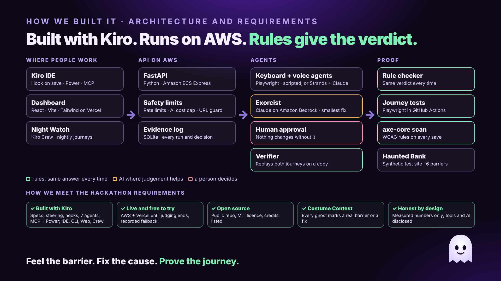

# Haunted Audit · System Design · V1

Version V1 · 22 Nov 2026 · Kiroween 2026, Costume Contest

Haunted Audit is an accessibility guardrail for AI-built apps. Instead of listing rule IDs like a scanner, it proves whether a person can actually finish a task: agents that use only a keyboard (and a voice-command simulation) try to send a €50 payment, a fix is proposed, a person approves it, the fix is proven on a copy, and a journey test stops the bug coming back.

## 1. Goals and non-goals

**Goals (MVP)**

- Prove whether a keyboard-only user can finish one critical journey: sending a payment on a synthetic bank.
- Show where and why they get stuck, with evidence anyone can check.
- Propose the smallest fix, apply it only after a person approves, and prove it on a patched copy.
- Turn every verified fix into a journey test so the same bug cannot return unnoticed.
- Run inside the developer's workflow in Kiro (hook on save, Power, MCP) and every night (Night Watch on Kiro Crew).

**Non-goals (left out on purpose)**

- Logging in or acting on real websites. Public URLs are scan-only.
- Real payments or real customer data. The bank is synthetic.
- Automatic merges. A person approves every change.
- Any claim of WCAG certification or full compliance.

## 2. Design principles

1. **Rules give the verdict, not the AI.** A rule-based checker decides PASSED or BLOCKED, so an agent can never mark its own work.
2. **AI only where judgement helps.** Navigating unknown pages and proposing fixes may use AI. Detection, severity and verdicts use rules.
3. **A person decides every change.** Fixes are proposed, never applied, until someone presses Approve.
4. **Prove on a copy.** Fixes are tested on a patched copy of the page, never on live code.
5. **Measured numbers only.** Every number shown comes from a recorded run, labelled with the agent mode that produced it.

## 3. Architecture

Four layers, left to right:

| Layer | Component | Tech | Responsibility | Where in the repo |
|---|---|---|---|---|
| Where people work | Kiro IDE integration | Kiro hook, Kiro Power, MCP server | Scan on save; run the journey from Kiro chat | `.kiro/hooks/`, `.kiro/scripts/`, `power/` |
| | Dashboard | React, Vite, Tailwind, React Router on Vercel | Possession Mode, Ghost Hunt, Find / Fix / Verify / Regression pages, Calm mode | `dashboard/` |
| | Night Watch | Kiro Crew app (separate repo) | Re-run the journey nightly and report any returning ghost | `haunted-audit-crew` repo |
| API on AWS | API | Python, FastAPI, Uvicorn in a Docker container on Amazon ECS Express Mode | Start runs, stream live steps, store results | `agent/api/main.py` |
| | Safety limits | Python | Rate limits, AI cost cap, URL guard, bundled-site-only browser | `agent/api/limits.py`, `agent/api/url_guard.py` |
| | Evidence log | SQLite | One record per run and per step | `agent/api/main.py` (`runs`, `events` tables) |
| Agents | Keyboard agent | Playwright; scripted walker, or Strands Agents with Claude on Amazon Bedrock | Try the journey with keyboard actions only | `agent/keyboard_agent/` |
| | Voice-command agent | Playwright | Try the journey by saying a control's visible name | planned: `agent/voice_agent/`; UI panel in `dashboard/src/voice/` |
| | Exorcist | Claude on Amazon Bedrock, or a labelled scripted fix | Explain the cause and propose the smallest fix | spec: `.kiro/specs/exorcist/` |
| | Human approval | API + dashboard | Approve or reject a proposed fix | spec: `.kiro/specs/exorcist/` |
| | Verifier | Playwright on a patched copy | Replay the keyboard and voice journeys after the fix | spec: `.kiro/specs/fix-verify-prevent/` |
| Proof | Rule checker | Python | Decide PASSED or BLOCKED with a reason code | `agent/keyboard_agent/checker.py` |
| | Journey tests | Playwright Test in GitHub Actions | Fail if a fixed bug returns | `tests/journeys/`, `.github/workflows/` |
| | Accessibility scan | axe-core | WCAG rule findings | `.kiro/scripts/axe-on-save.mjs`; scanner planned |
| | Haunted Bank | Static HTML | Synthetic test bank with 6 planted barriers and an answer key | `fixtures/haunted_bank/index.html`, `bank/PLANTED.md` |

## 4. Main flow: one run

1. **Start.** A person presses Run Journey in the dashboard (variant `broken` or `fixed`, mode `scripted` or `llm`). The dashboard calls `POST /runs`.
2. **Guard.** The API checks the limits and returns a run ID (HTTP 202).
3. **Walk.** The API opens Chromium with Playwright on the bundled Haunted Bank page. The keyboard agent may only use keyboard tools: `press_tab`, `press_shift_tab`, `press_enter`, `press_space`, `press_arrow`, `type_text`, `read_focus` and `read_page`. It never clicks.
4. **Stream.** Each step (key pressed, element focused, accessible name) is saved to `events` and streamed to the dashboard through `GET /runs/{id}/events` (Server-Sent Events with keep-alive).
5. **Decide.** The rule checker reads the observation and returns a verdict. The agent's own claim is ignored.
6. **Store.** The final result, focus trail and verdict are saved to `runs` and returned by `GET /runs/{id}`.

On the broken bank, Send Payment is a `div` with a click handler. Tab never reaches it, so the verdict is **BLOCKED · TARGET_NOT_FOCUSABLE**. On the fixed bank it is a real button, so the verdict is **PASSED**.

## 5. Fix, approve, verify, prevent (the loop)

1. **Find.** A BLOCKED run names the blocked element and the reason code.
2. **Propose.** The Exorcist reads the blocked element and the page source and proposes the smallest change (for barrier 1: replace the `div` with `<button type="submit">`, keeping the click behaviour). The diff is stored with a SHA-256 hash.
3. **Approve.** A person presses Approve or Reject. Approval is accepted only if the diff hash is unchanged and the fix is still `proposed`. There is no automatic approval.
4. **Verify.** The Verifier applies the approved diff to a copy of the page and replays both journeys (keyboard and voice), each with its own run ID. BLOCKED must become VERIFIED.
5. **Prevent.** The verified fix becomes a Playwright journey test. "Summon the Ghost Again" puts the defect back on purpose: the test fails with a clear message, then passes when the fix is restored.

## 6. API

| Method and path | Purpose | Status |
|---|---|---|
| `GET /ping` | Wake-up and liveness check | Built |
| `GET /health` | Health check | Built |
| `POST /runs` | Start a journey run (`variant`, `mode`) | Built |
| `GET /runs/{run_id}` | Run result: verdict, reason code, steps, focus trail | Built |
| `GET /runs/{run_id}/events` | Live steps as Server-Sent Events | Built |
| `POST /fixes` | Ask the Exorcist for a fix for a blocked run | Designed |
| `POST /fixes/{id}/approve` | Approve (body: `diff_sha256`, optional note); 422 if the diff changed, 409 if already decided | Designed |
| `POST /fixes/{id}/reject` | Reject (optional note) | Designed |
| `POST /verify` | Replay both journeys on the patched copy | Designed |
| `POST /regression/demo` | Put the defect back, run the journey test, restore | Designed |

## 7. Data

**Built (SQLite)**

- `runs`: `run_id`, `variant`, `mode`, `status`, `verdict`, `reason_code`, `json` (full result), `created_at`, `seeded`, `recorded_at`.
- `events`: `id`, `run_id`, `seq`, `json` (one step).

**Designed**

- `fixes`: one row per proposed fix: run, finding, diff and its hash, Exorcist mode and model, tokens, cost, latency, status (`proposed`, `approved`, `rejected`, `exorcist_failed`), who decided and when.
- `fix_events`: append-only history of every status change. Rows are never deleted.

`docs/evidence-seed.json` holds real recorded runs used by the recorded fallback when the live API is unavailable.

## 8. Agent modes and verdicts

| | Scripted mode | AI mode |
|---|---|---|
| Who chooses each key press | Fixed code (`scripted_walker.py`) | Claude on Amazon Bedrock through Strands Agents (`agent.py`) |
| Tools and checker | Same 9 keyboard tools, same rule checker | Same |
| Use | Demo, tests, all measured evidence | Unknown pages; shown only when measured |
| Measured result | 10 of 10 correct (5 broken, 5 fixed) | Not yet run: no AWS credentials (see `docs/decision-log.md`) |

**Reason codes from the checker:** `TARGET_NOT_FOCUSABLE`, `FOCUS_TRAP`, `NO_ACTIVATION`, `STEP_LIMIT`, `TIMEOUT`.

## 9. Safety and cost controls

| Control | Default |
|---|---|
| AI mode on the public link | Off (`LLM_ENABLED=false`) |
| AI runs per day | 20 (`LLM_DAILY_RUN_CAP`) |
| Runs per visitor | 5 a minute, 30 an hour |
| Runs at once | 2 |
| Where agents may act | Only the bundled synthetic bank; private and local addresses blocked |
| Public URLs | Scan only: no clicks, no typing, no logins, page content not kept |
| Changes to code | Only after a person approves, tested on a copy first |
| Secrets | Read from environment variables; `.env` is git-ignored; no page HTML or model output in INFO logs |
| AWS spend | $150 budget with an alert |

## 10. Deployment

- **API:** Docker image based on the official Playwright Python image, run as a non-root user with `tini`, Uvicorn on port 8000. Pushed to Amazon ECR and run on Amazon ECS Express Mode; logs in CloudWatch.
- **Dashboard:** static build on Vercel; `VITE_API_URL` points at the API, and the API allows the Vercel origin through `CORS_ALLOWED_ORIGINS`.
- **Fallback:** if the API cannot be reached, the dashboard replays a real recorded run, clearly labelled "Recorded run, not live".
- **Live until:** the end of judging, 29 Jan 2027.

## 11. Testing and evaluation

| What | How | Where |
|---|---|---|
| Backend unit and API tests | pytest and Hypothesis | `agent/tests/` |
| Bank barriers | One "present when haunted" and one "repaired when fixed" test per barrier | `agent/tests/test_bank_barriers.py` |
| Dashboard | Vitest with axe accessibility checks | `dashboard/src/test/` |
| Agent reliability | Each mode run 5 times per variant; AI steps must pass at least 4 of 5 | `agent/eval/run_eval.py` |
| Benchmark | 12 labelled cases: precision, recall, false positives, fixes verified, returning ghosts caught | `evals/`, results in `docs/eval.md` |
| Journey tests | Playwright Test on every push and pull request | `tests/journeys/`, GitHub Actions |

## 12. How Kiro is used to build it

| Kiro feature | Use in this project | Where |
|---|---|---|
| Specs | Requirements → design → tasks for every feature | `.kiro/specs/` |
| Steering | Product, tech, structure, accessibility and data-contract rules | `.kiro/steering/` |
| Hooks | Accessibility scan on save | `.kiro/hooks/axe-on-save.json` |
| Custom agents | Planner, Architect, Developer, QA, Reviewer, Deployer, Monitor, each with limited permissions | `.kiro/agents/` |
| MCP and Power | Run the journey from Kiro chat; installable on any laptop | `power/` |
| Kiro CLI | QA agent runs the 5-run checks | `kiro-cli --agent qa` |
| Kiro Web | Fix a tester-reported GitHub issue | linked pull request |
| Kiro Crew | Night Watch, nightly journeys | `haunted-audit-crew` repo |

Code was written in Kiro, with Claude AI helping on some tasks; the devlog says which.

## 13. Build status (22 Nov 2026)

| Area | Status |
|---|---|
| Haunted Bank with 6 planted barriers and answer key | Built (branch, merge pending) |
| Keyboard agent, scripted mode, and rule checker | Built |
| Keyboard agent, AI mode | Built, not yet run (no AWS credentials) |
| API, limits, SQLite evidence, container | Built, not yet deployed |
| Dashboard (Possession Mode, Ghost Hunt, multipage) | Partly built |
| Voice-command agent | Partly built (dashboard panel only) |
| Exorcist, approval, Verifier, journey tests | Designed, not built |
| Kiro hook | Built; form check to add |
| Steering and custom agents | Built (branch, merge pending) |
| MCP and Power, scanner, benchmark, Night Watch | Not started |

This table is updated as each feature is merged.

## 14. Known limits and next steps

- The voice agent is a voice-command simulation, not a screen-reader study or a test with real voice-control users.
- Scans of public pages are automated only and cannot prove a page is accessible.
- SQLite suits one team; a managed database is needed at scale.
- Next: a screen-reader agent, fixes delivered as reviewed pull requests, checks on every pull request, validation with assistive-technology users, and 2 to 3 pilots with banks, fintechs or agencies.
